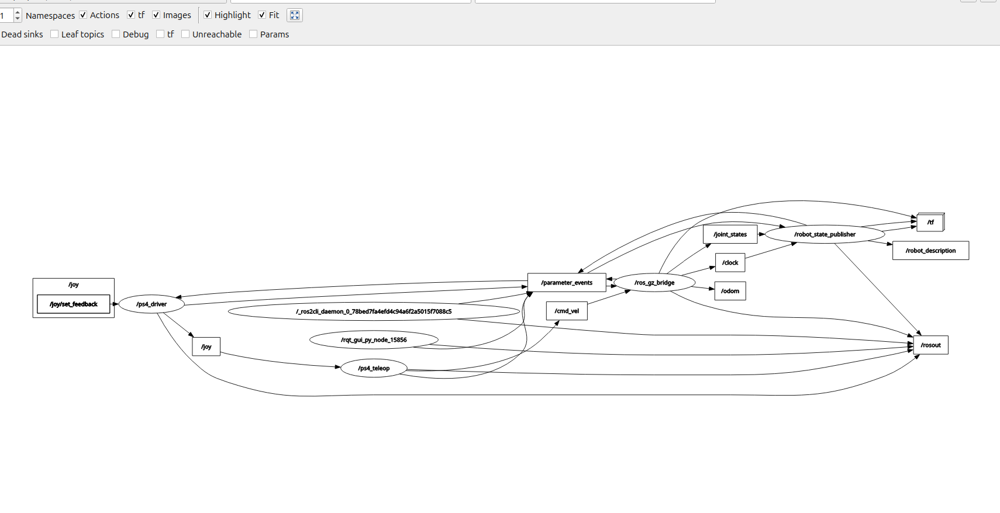

# Colmibot — Modelo en RViz y Gazebo

## Descripción

Este paquete contiene el modelo de Colmibot para ROS 2 Jazzy. El modelo
se puede visualizar en RViz y también se puede ejecutar como un robot
diferencial en Gazebo Harmonic.

La simulación utiliza las mallas actualizadas del ensamble de SolidWorks,
las propiedades físicas calculadas para el chasis y las ruedas, colisiones
simplificadas y un sistema de control diferencial. El mando PS4 permite
enviar órdenes de avance, retroceso y giro al robot simulado.

La simulación permite comprobar la arquitectura de comunicación y el
comportamiento general del robot. No representa con exactitud todos los
contactos, deformaciones, pérdidas mecánicas o características eléctricas
del Colmibot físico.

## Herramientas utilizadas

- Ubuntu 24.04
- ROS 2 Jazzy
- Gazebo Harmonic 8
- `ros_gz` para comunicar ROS 2 con Gazebo
- RViz para visualizar el modelo y sus transformaciones
- SolidWorks para consultar el ensamble y sus propiedades físicas
- Archivos STL para representar la geometría visual
- `joy` para leer el mando PS4
- Python y `rclpy` para convertir el mando en comandos de velocidad

## Estructura del sistema

Los paquetes utilizados son:

- `robot_description`: contiene el URDF, las mallas y los archivos launch
- `leakscout_teleop`: convierte las entradas del mando PS4 en velocidades

Los archivos principales son:

- `meshes/chasis.STL`: geometría visual del chasis actualizado
- `meshes/rueda_izquierda.STL`: geometría visual de la rueda izquierda
- `meshes/rueda_derecha.STL`: geometría visual de la rueda derecha
- `urdf/robot.urdf`: enlaces, articulaciones, propiedades físicas y plugins
- `launch/display.launch.py`: visualización del modelo en RViz
- `launch/gazebo.launch.py`: simulación completa con Gazebo y mando PS4
- `rviz/display.rviz`: configuración de RViz
- `docs/grafo_comunicacion_gazebo.png`: evidencia de la comunicación ROS 2

## Preparación del modelo

Las mallas se exportaron en milímetros. El URDF conserva los archivos sin
modificar sus vértices y utiliza una escala de `0.001` para representarlos
en metros. No se aplica otra conversión de escala.

En el sistema del CAD, X es el eje lateral, Y es vertical y Z es
longitudinal. El modelo se transformó a la convención de ROS:

- X apunta hacia el frente
- Y apunta hacia la izquierda
- Z apunta hacia arriba

El frente corresponde a la dirección de la cámara Logitech C920. La
transformación utilizada para el chasis conserva esta orientación y evita
que el robot aparezca acostado en RViz o Gazebo.

Las mallas de las ruedas tienen coordenadas locales. Cada articulación se
colocó en el centro geométrico de la banda de rodamiento para que las
ruedas giren sobre su propio eje y no orbiten alrededor del chasis.

## Parámetros físicos

Los valores principales utilizados son:

| Parámetro | Valor |
| --- | ---: |
| Masa del chasis sin ruedas motrices | 2.2407514 kg |
| Masa de cada rueda | 0.0193581 kg |
| Masa total | 2.2794676 kg |
| Radio de las ruedas | 0.030 m |
| Ancho de la banda de rodamiento | 0.006 m |
| Separación entre centros de las ruedas | 0.178095 m |
| Radio de cada apoyo esférico | 0.0079375 m |

El centro de masa y la matriz de inercia del chasis se tomaron respecto a
su centro de masa y se transformaron de los ejes del CAD a los ejes ROS.
Las unidades se convirtieron de gramos y milímetros a kilogramos y metros.

Las ruedas utilizan su masa e inercia respecto al centro de masa. Los
pequeños desplazamientos entre el centro geométrico y el centro de masa se
conservan en sus elementos `inertial`.

## Colisiones y apoyos

Las mallas visuales contienen cientos de miles de triángulos. No se usan
directamente como colisiones porque elevarían innecesariamente el costo de
la simulación y podrían producir contactos inestables.

Se utilizan las siguientes aproximaciones:

- Una caja para el cuerpo principal
- Un cilindro de 30 mm de radio para cada rueda
- Dos esferas para los apoyos delantero y trasero

Los apoyos ya forman parte de la masa e inercia del chasis. Las esferas
solo se agregaron como geometría de contacto, por lo que no duplican masa.
La fricción de los apoyos es menor que la de las ruedas para permitir el
giro diferencial.

## Articulaciones y control diferencial

Las ruedas se conectan a `base_link` mediante:

- `wheel_left_joint`
- `wheel_right_joint`

Ambas articulaciones son continuas y sus ejes son paralelos al eje Y del
robot. Gazebo utiliza el plugin `DiffDrive` con el radio y la separación
medidos para convertir una orden de velocidad en el movimiento de ambas
ruedas.

El plugin también publica odometría y un sistema adicional publica los
estados de las articulaciones. El puente `ros_gz_bridge` comunica estos
mensajes entre Gazebo Transport y ROS 2.

## Arquitectura de comunicación

La comunicación principal es:

```text
Mando PS4
   │
   ▼
game_controller_node
   │  /joy                 sensor_msgs/msg/Joy
   ▼
ps4_teleop
   │  /cmd_vel             geometry_msgs/msg/Twist
   ▼
ros_gz_bridge
   │
   ▼
DiffDrive de Gazebo
   ├── /odom               nav_msgs/msg/Odometry
   └── /joint_states       sensor_msgs/msg/JointState
                               │
                               ▼
                      robot_state_publisher
                               │
                               └── /tf
```

El nodo de teleoperación publica velocidad cero cuando deja de recibir
datos válidos del mando durante 0.5 segundos. Esto permite detener el
robot simulado si se desconecta el control.

## Controles del mando PS4

- R2: avance
- L2: retroceso
- Stick derecho horizontal: giro a izquierda o derecha
- Controles sueltos: velocidad cero

En el launch de Gazebo se limita la velocidad lineal a `0.40 m/s` y la
velocidad angular a `2.00 rad/s`. Estos valores son parámetros del nodo y
se pueden modificar sin cambiar su lógica.

## Dependencias

Partiendo de una instalación de ROS 2 Jazzy:

```bash
sudo apt update
sudo apt install \
  python3-colcon-common-extensions \
  ros-jazzy-ros-gz \
  ros-jazzy-robot-state-publisher \
  ros-jazzy-joint-state-publisher-gui \
  ros-jazzy-rviz2 \
  ros-jazzy-joy \
  ros-jazzy-rqt-graph
```

La combinación utilizada es ROS 2 Jazzy con Gazebo Harmonic. No se usan
los paquetes de Gazebo Classic.

## Compilación

Desde el workspace:

```bash
cd ~/leakscout_ws
source /opt/ros/jazzy/setup.bash
colcon build --packages-select leakscout_teleop robot_description --symlink-install
source install/setup.bash
```

## Ejecución completa en Gazebo

Con el mando PS4 conectado:

```bash
cd ~/leakscout_ws
source /opt/ros/jazzy/setup.bash
source install/setup.bash
QT_QPA_PLATFORM=xcb ros2 launch robot_description gazebo.launch.py
```

El launch inicia:

- Gazebo Harmonic con un mundo vacío y un plano de suelo
- El modelo de Colmibot a una altura de 13.5 mm sobre el origen
- `robot_state_publisher`
- `ros_gz_bridge`
- `game_controller_node`
- `ps4_teleop`

Solo se debe mantener una ejecución del launch. Para detener todo el
sistema se presiona `Ctrl+C` en la terminal correspondiente.

## Prueba sin joystick

Para iniciar únicamente la simulación:

```bash
QT_QPA_PLATFORM=xcb ros2 launch robot_description gazebo.launch.py \
  use_joystick:=false
```

En otra terminal se puede comprobar el avance:

```bash
source /opt/ros/jazzy/setup.bash
source ~/leakscout_ws/install/setup.bash

timeout 2s ros2 topic pub --rate 10 /cmd_vel geometry_msgs/msg/Twist \
  "{linear: {x: 0.15}, angular: {z: 0.0}}" || true

ros2 topic pub --once /cmd_vel geometry_msgs/msg/Twist \
  "{linear: {x: 0.0}, angular: {z: 0.0}}"
```

La segunda orden detiene explícitamente el robot. `timeout` puede mostrar
un mensaje al terminar el proceso a la fuerza; esto no representa una
falla del simulador.

## Verificación con comandos de ROS 2

Con el sistema funcionando:

```bash
ros2 node list
ros2 topic info /joy
ros2 topic info /cmd_vel
ros2 topic info /odom
ros2 topic info /joint_states
ros2 topic echo /odom --once
ros2 topic echo /joint_states --once
```

Durante la comprobación se observaron estos nodos:

```text
/ps4_driver
/ps4_teleop
/robot_state_publisher
/ros_gz_bridge
```

Se comprobó que `/joy` y `/cmd_vel` tenían un publicador y un suscriptor.
También se comprobó que `/odom` y `/joint_states` eran publicados por la
simulación. Después de una prueba de avance, ambas ruedas reportaron casi
la misma posición angular, y una orden angular positiva produjo un giro a
la izquierda.

El grafo se puede abrir con:

```bash
ros2 run rqt_graph rqt_graph
```

## Visualización en RViz

La actividad anterior de RViz se conserva. Se ejecuta con:

```bash
cd ~/leakscout_ws
source /opt/ros/jazzy/setup.bash
source install/setup.bash
QT_QPA_PLATFORM=xcb ros2 launch robot_description display.launch.py
```

Este launch utiliza `joint_state_publisher_gui` para modificar los ángulos
de las ruedas manualmente. No se debe ejecutar al mismo tiempo que el
launch de Gazebo, porque ambos podrían publicar estados articulares.

## Problemas encontrados y soluciones

### Gazebo no estaba instalado

El equipo tenía ROS 2 Jazzy, pero no incluía Gazebo. Se instaló el paquete
`ros-jazzy-ros-gz`, que proporciona Gazebo Harmonic y su integración con
ROS 2.

### Conversión de ejes del CAD

El ensamble no utilizaba la convención de ejes de ROS. Se documentó y
aplicó una transformación consistente a la geometría, centros de masa,
posiciones de ruedas y matrices de inercia.

### Ruedas exportadas en coordenadas locales

Las ruedas no conservaban la posición global del ensamble. Se localizaron
con sus centros geométricos medidos y se mantuvieron como enlaces separados
para que giraran sobre su centro.

### Mallas demasiado densas para colisión

El chasis actualizado tiene más de setecientos mil triángulos. Se conservó
la malla para visualización y se sustituyó por primitivas simples para los
cálculos de contacto.

### Modelo muy pequeño al abrir Gazebo

El robot sí se había cargado, pero la cámara inicial estaba alejada. Se
seleccionó `colmibot` en el árbol de entidades y se presionó `F` para
centrar la vista.

### Parada después de una publicación temporal

Una orden de velocidad permanece activa hasta recibir una nueva orden. En
las pruebas manuales siempre se envió un mensaje de velocidad cero después
de utilizar `timeout`. El nodo del mando realiza esta actualización de
forma continua y también se detiene por pérdida de datos.

## Modificación para la revisión en clase

Una modificación sencilla es reducir la velocidad máxima del robot. En
`launch/gazebo.launch.py` se puede cambiar:

```python
'max_linear': 0.40,
```

por:

```python
'max_linear': 0.20,
```

Después se vuelve a compilar y ejecutar el launch. Esta modificación
demuestra que el launch configura el nodo de teleoperación y que la orden
publicada en `/cmd_vel` determina la velocidad del control diferencial.

## Evidencias

### Grafo de comunicación



### Video de la actividad anterior en RViz

[Ver video del modelo y las articulaciones en RViz](https://drive.google.com/file/d/18gwdypMfG76y5TjWGCVo_H3EmoUbDE0k/view?usp=drive_link)

### Video de Gazebo

Pendiente de agregar después de grabar la demostración final.

## Autor

Ivan Vazquez Villar
